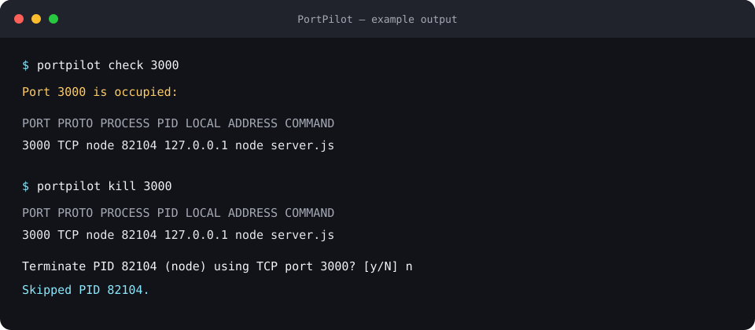

# PortPilot

PortPilot is a local, cross-platform CLI for finding TCP/UDP sockets, checking ports, and safely managing the process that owns a port. It has no backend, account, or telemetry.

## Install

Build from source with Go 1.26 or later:

```sh
go install github.com/portpilot/portpilot/cmd/portpilot@latest
```

Or clone this repository and run `go build -o portpilot ./cmd/portpilot`. The `go install` command is available once the module is published.

## Usage

```sh
portpilot check 3000
portpilot list
portpilot list --json
portpilot list --range 3000-4000 --process node
portpilot kill 3000
portpilot kill 3000 --force
portpilot available --range 3000-4000
portpilot available --range 8000-8100 --count 3
portpilot watch
portpilot info
```

`check` and `kill` accept ports 1 through 65535. `list` reports listening TCP sockets; `check` and `kill` also recognize bound UDP sockets. When the OS cannot provide process details, `check` still probes loopback and reports the port as occupied with an unknown owner. Process command lines are shown when the OS permits access. Insufficient permissions may limit which processes or details the operating system exposes.

`kill` always describes the process and asks before terminating it. `--force` skips the prompt. When terminating, PortPilot rechecks that the same process identity still owns the requested port and refuses if it cannot verify that identity. `available` briefly binds each candidate TCP port on IPv4 loopback and releases it immediately; another process may claim a suggested port after the check.

`watch` checks once per second by default. Change the interval with `--interval 2s`; use Ctrl+C to stop.

### Example



```text
$ portpilot check 3000
Port 3000 is occupied:
PORT  PROTO  PROCESS  PID    LOCAL ADDRESS  COMMAND
3000  TCP    node     82104  127.0.0.1      node server.js

$ portpilot kill 3000
PORT  PROTO  PROCESS  PID    LOCAL ADDRESS  COMMAND
3000  TCP    node     82104  127.0.0.1      node server.js
Terminate PID 82104 (node) using TCP port 3000? [y/N] n
Skipped PID 82104.
```

## Build

The CLI uses Cobra for commands, Lip Gloss for status styling, and gopsutil for cross-platform socket and process inspection.

```sh
go test ./...
go build -o dist/portpilot ./cmd/portpilot
```

Cross-compile from any supported Go host:

```sh
GOOS=linux   GOARCH=amd64 go build -o dist/portpilot-linux-amd64 ./cmd/portpilot
GOOS=darwin  GOARCH=arm64 go build -o dist/portpilot-darwin-arm64 ./cmd/portpilot
GOOS=windows GOARCH=amd64 go build -o dist/portpilot-windows-amd64.exe ./cmd/portpilot
```

Tagged releases are built for Windows, macOS, and Linux (amd64 and arm64) and published as compressed archives by GitHub Actions. To publish from the current `main` commit, open **Actions → CI → Run workflow**, enter a new version such as `v0.1.0`, and start the run. The workflow tests the commit, creates the version tag, and publishes the release. You can also publish by pushing a `v*` tag directly. See the [CI workflow](.github/workflows/ci.yml).

## Platform notes

Socket/process visibility is governed by the host operating system. PortPilot does not request administrator privileges, but some process names, command lines, or sockets owned by other users may be unavailable without elevated permissions. Port discovery includes listening TCP sockets and bound UDP sockets; `list` intentionally shows TCP listeners only.

## License

MIT; see [LICENSE](LICENSE).
